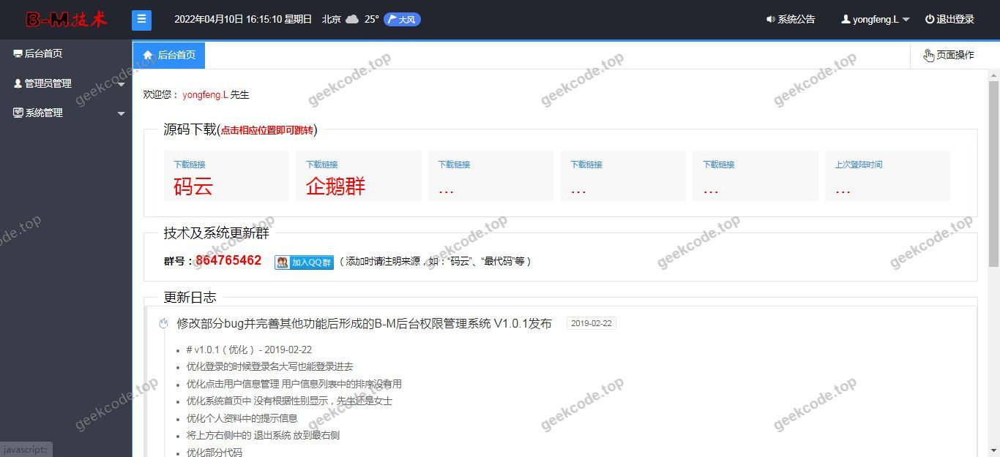
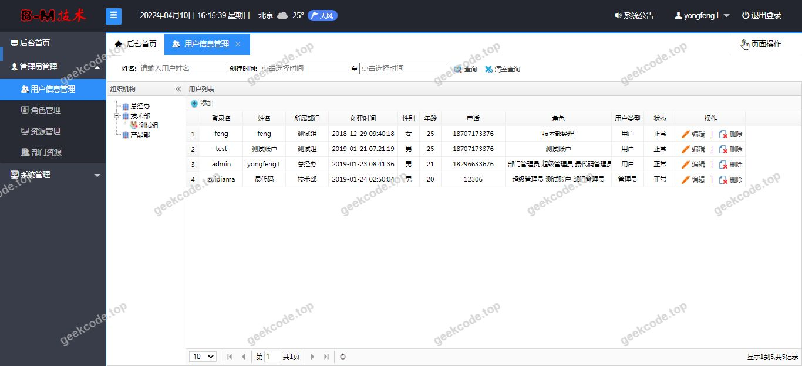
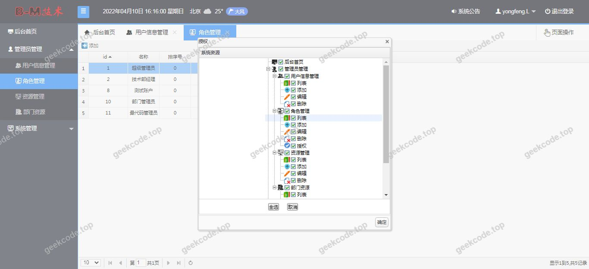
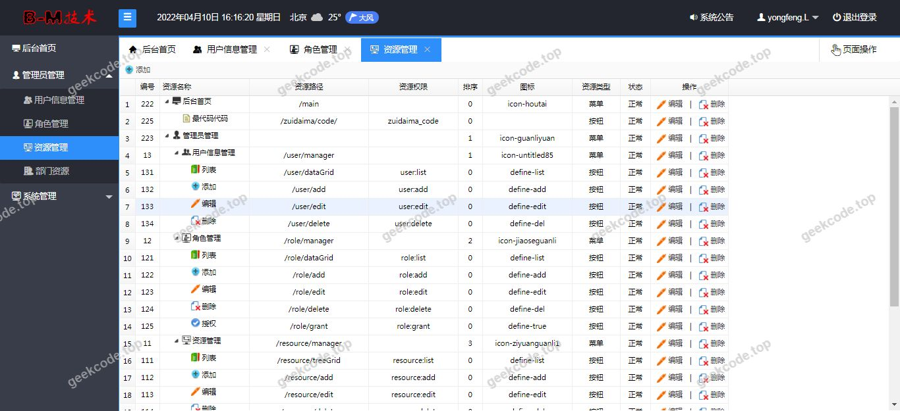
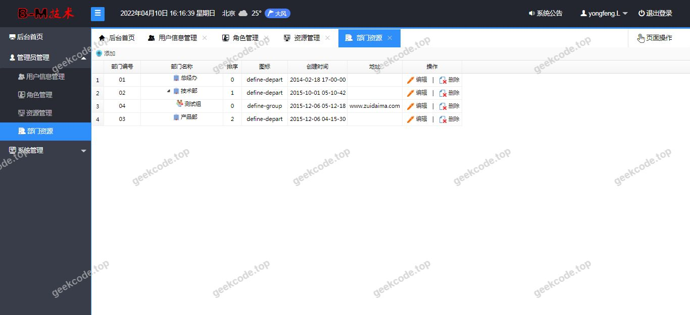

# java精品项目-基于SSM+Shiro+LayUI+EasyUI的权限管理系统【毕业设计】

> 🎓 **计算机毕业设计 · java精品项目-基于SSM+Shiro+LayUI+EasyUI的权限管理系统【毕业设计】**
>
> 本仓库只放**项目介绍 + 运行截图**（截图是站点带水印的原图，存在仓库 `images/` 里）。
>
> 👉 **完整可运行源码 / 数据库脚本 / 部署文档：[点我获取](https://geekcode.top/archives/java%E7%B2%BE%E5%93%81%E9%A1%B9%E7%9B%AE-%E5%9F%BA%E4%BA%8ESSM-Shiro-LayUI-EasyUI%E7%9A%84%E6%9D%83%E9%99%90%E7%AE%A1%E7%90%86%E7%B3%BB%E7%BB%9F%E3%80%90%E6%AF%95%E4%B8%9A%E8%AE%BE%E8%AE%A1%E3%80%91?utm_source=github)**
>
> 💬 咨询微信：**ir9372**　|　🌐 更多项目：[极客代码 geekcode.top](https://geekcode.top/?utm_source=github)
>
> 📌 项目详情页：<https://geekcode.top/archives/java%E7%B2%BE%E5%93%81%E9%A1%B9%E7%9B%AE-%E5%9F%BA%E4%BA%8ESSM-Shiro-LayUI-EasyUI%E7%9A%84%E6%9D%83%E9%99%90%E7%AE%A1%E7%90%86%E7%B3%BB%E7%BB%9F%E3%80%90%E6%AF%95%E4%B8%9A%E8%AE%BE%E8%AE%A1%E3%80%91?utm_source=github>

<table><td width="230" align="center"> <b>扫码加微信 ir9372</b></td><td valign="middle">📦 源码 = 项目介绍 + 全部运行截图 + 数据库 + 部署文档 👉 点上方任意截图，直接跳到 <b>极客代码 geekcode.top</b> 详情页</td></table>

---

<h1>java精品项目-基于SSM+Shiro+LayUI+EasyUI的权限管理系统【毕业设计】</h1>
<h2>项目概述</h2>

本项目为基于 SSM（Spring + Spring MVC + MyBatis）架构，结合 Apache Shiro 安全框架与 LayUI/EasyUI 前端组件开发的权限管理系统。系统旨在解决传统 Web 应用中用户认证、授权及会话管理的复杂性问题，提供一套标准化、可扩展的后台管理解决方案。核心功能涵盖用户身份验证、细粒度权限控制、角色管理及菜单动态加载。适用人群主要为需要构建企业级内部管理系统或毕业设计展示 Java Web 全栈开发能力的开发者。技术架构上，后端采用 Spring 容器进行依赖注入与事务管理，MyBatis 负责持久层操作，Druid 作为数据库连接池优化性能；前端利用 LayUI 和 EasyUI 实现响应式界面交互，通过 JSP 模板引擎渲染页面。

<h2>技术架构</h2>
<h3>后端架构</h3>

系统后端严格遵循 MVC 设计模式，具体分层如下：

<ul>
<li><strong>表现层</strong>：由 Spring MVC 控制器处理 HTTP 请求，返回 JSP 视图模型。</li>
<li><strong>业务逻辑层</strong>：Spring Service 层封装核心业务规则，并通过 <code>spring-tx</code> 实现声明式事务管理。</li>
<li><strong>数据访问层</strong>：MyBatis Mapper 接口映射 SQL 语句，实现对象关系映射。</li>
<li><strong>安全模块</strong>：集成 Apache Shiro，实现 Realm 自定义认证与授权策略，拦截器配置用于保护资源访问。</li>
<li><strong>基础设施</strong>：使用 Druid 连接池管理数据库连接，提升高并发下的稳定性；AspectJ 实现 AOP 切面编程，用于日志记录或通用横切关注点处理。</li>
</ul>
<h3>前端架构</h3>

前端采用服务端渲染（SSR）模式，基于 JSP 技术。UI 组件库选用 LayUI 和 EasyUI，提供丰富的表格、表单、弹窗及导航组件，确保界面美观且符合现代 Web 设计规范。前端路由与菜单结构由后端根据用户权限动态生成并下发至页面。

<h3>核心技术选型理由</h3>
<ul>
<li><strong>Shiro</strong>：相比 Spring Security，Shiro 更轻量且易于集成，适合中小型项目的快速开发。</li>
<li><strong>LayUI/EasyUI</strong>：成熟的前端 UI 框架，减少了 CSS/JS 手写工作量，提高了开发效率。</li>
<li><strong>Druid</strong>：阿里开源的高性能数据库连接池，具备监控功能，便于排查 SQL 执行问题。</li>
</ul>
<h2>功能模块</h2>

根据现有源码上下文及截图信息，系统主要包含以下功能模块：

<h3>系统运行界面模块</h3>
<ul>
<li><strong>登录界面</strong>：用户输入账号密码，经 Shiro 认证后进入系统主页。</li>
<li><strong>主框架页</strong>：包含顶部导航栏、左侧菜单树及右侧内容区域 iframe 框架。</li>
<li><strong>仪表盘首页</strong>：展示系统概览信息，如欢迎语、当前登录用户信息等。</li>
<li><strong>基础管理页面</strong>：包括用户列表、角色列表等数据的增删改查界面（依据常规权限系统设计推断，具体字段以实际数据库为准）。</li>
</ul>

<em>注：由于提供的“代码上下文”仅包含依赖库名称，未提供具体的 Controller 方法名或 Service 业务逻辑细节，且“截图功能列表”仅标注为“系统运行界面”，未描述具体业务动作，因此无法列出更细致的 CRUD 操作模块。以上模块基于项目名称“权限管理系统”及标准 SSM+Shiro 架构的典型功能构成。</em>

<h2>用户角色与权限</h2>

本项目基于 Apache Shiro 实现 RBAC（基于角色的访问控制）模型。虽然具体角色定义未在代码片段中显式列出，但依据权限管理系统通用设计及 Shiro 机制，通常包含以下角色层级：

<h3>超级管理员 (Admin)</h3>
<ul>
<li><strong>权限范围</strong>：拥有系统最高权限。</li>
<li><strong>可访问模块</strong>：<ul>
<li>用户管理：创建、编辑、删除所有用户账户，重置密码。</li>
<li>角色管理：分配角色给特定用户，修改角色权限集合。</li>
<li>菜单/权限管理：配置系统菜单树，定义 URL 资源的访问权限。</li>
<li>系统监控：查看在线用户、服务器状态等。</li>
</ul>
</li>
</ul>
<h3>普通用户 (User)</h3>
<ul>
<li><strong>权限范围</strong>：受限访问，仅能查看和操作被授权的数据。</li>
<li><strong>可访问模块</strong>：<ul>
<li>个人中心：修改自身基本信息、头像、密码。</li>
<li>业务数据查看：根据角色配置，可能仅允许读取特定报表或记录，无编辑或删除权限。</li>
</ul>
</li>
</ul>

<em>说明：具体角色名称及对应的权限标识符（Permission Strings）需查阅项目中的 <code>shiro.ini</code> 配置文件或数据库中的 <code>sys_role</code>, <code>sys_permission</code> 表才能完全确定。上述描述为该类系统的标准权限模型。</em>

<h2>项目特色与创新点</h2>
<ol>
<li><strong>前后端分离思想的混合应用</strong>：虽采用 JSP 服务端渲染，但通过 LayUI/EasyUI 实现了类似 SPA（单页应用）的局部刷新体验，提升了用户操作的流畅度。</li>
<li><strong>细粒度权限控制</strong>：利用 Shiro 的注解（如 <code>@RequiresPermissions</code>）和标签（如 ``），实现了从按钮级别到 URL 级别的全面权限校验，确保数据安全。</li>
<li><strong>高性能连接池集成</strong>：引入 Druid 连接池，不仅提供了高效的数据库连接复用，还内置了 SQL 监控面板，有助于开发阶段发现慢查询和优化数据库性能。</li>
<li><strong>模块化设计</strong>：基于 Maven 的多模块或清晰的分包结构（Controller, Service, Dao, Entity），使得代码耦合度低，便于后期维护和功能扩展。</li>
</ol>
<h2>部署环境</h2>

为确保系统正常运行，需准备以下软件环境：

<table>
<thead>
<tr>
<th align="left">组件</th>
<th align="left">版本要求</th>
<th align="left">备注</th>
</tr>
</thead>
<tbody><tr>
<td align="left"><strong>JDK</strong></td>
<td align="left">1.8 或以上</td>
<td align="left">必须配置 JAVA_HOME 环境变量</td>
</tr>
<tr>
<td align="left"><strong>Servlet 容器</strong></td>
<td align="left">Tomcat 8.5 / 9.0</td>
<td align="left">用于部署 WAR 包或运行 JSP 页面</td>
</tr>
<tr>
<td align="left"><strong>数据库</strong></td>
<td align="left">MySQL 5.7 / 8.0</td>
<td align="left">需导入项目提供的 <code>.sql</code> 初始化脚本</td>
</tr>
<tr>
<td align="left"><strong>构建工具</strong></td>
<td align="left">Maven 3.6+</td>
<td align="left">用于依赖管理和项目打包</td>
</tr>
<tr>
<td align="left"><strong>IDE</strong></td>
<td align="left">IntelliJ IDEA / Eclipse</td>
<td align="left">推荐安装 Lombok 插件（若项目使用）</td>
</tr>
<tr>
<td align="left"><strong>浏览器</strong></td>
<td align="left">Chrome / Edge / Firefox</td>
<td align="left">建议最新版本以获得最佳 UI 兼容性</td>
</tr>
</tbody></table>

<strong>启动步骤简述：</strong>

<ol>
<li>修改 <code>application.properties</code> 或 <code>jdbc.properties</code> 中的数据库连接地址、用户名和密码。</li>
<li>在 MySQL 中创建数据库并执行初始化 SQL 脚本。</li>
<li>使用 Maven 命令 <code>mvn clean package</code> 打包项目。</li>
<li>将生成的 WAR 包部署至 Tomcat 的 <code>webapps</code> 目录，启动 Tomcat。</li>
<li>访问 <code>http://localhost:8080/[项目名]/login.jsp</code> 进行登录测试。</li>
</ol>
<h2>五、技术特性</h2>
<ul>
<li>服务端模板渲染（JSP）</li>
<li>集成 Shiro 权限框架实现角色权限控制</li>
</ul>
<h2>六、功能模块截图</h2>
<h3>前台用户端</h3>
<h4>系统运行界面1</h4>

<h4>系统运行界面2</h4>

<h4>系统运行界面3</h4>

<h4>系统运行界面4</h4>

<h4>系统运行界面5</h4>

<h4>系统运行界面6</h4>

---

## 获取完整源码

| 项目 | 说明 |
| --- | --- |
| 项目名 | java精品项目-基于SSM+Shiro+LayUI+EasyUI的权限管理系统【毕业设计】 |
| 运行截图 | 本文 6 张（站点带水印原图，仓库 `images/` 目录） |
| 完整源码 | [https://geekcode.top/archives/java%E7%B2%BE%E5%93%81%E9%A1%B9%E7%9B%AE-%E5%9F%BA%E4%BA%8ESSM-Shiro-LayUI-EasyUI%E7%9A%84%E6%9D%83%E9%99%90%E7%AE%A1%E7%90%86%E7%B3%BB%E7%BB%9F%E3%80%90%E6%AF%95%E4%B8%9A%E8%AE%BE%E8%AE%A1%E3%80%91?utm_source=github](https://geekcode.top/archives/java%E7%B2%BE%E5%93%81%E9%A1%B9%E7%9B%AE-%E5%9F%BA%E4%BA%8ESSM-Shiro-LayUI-EasyUI%E7%9A%84%E6%9D%83%E9%99%90%E7%AE%A1%E7%90%86%E7%B3%BB%E7%BB%9F%E3%80%90%E6%AF%95%E4%B8%9A%E8%AE%BE%E8%AE%A1%E3%80%91?utm_source=github) |
| 咨询微信 | **ir9372**（备注：jingpin-yuanma） |
| 更多项目 | [极客代码 geekcode.top](https://geekcode.top/?utm_source=github) |

> 需要源码、部署、改配置、跑不起来等问题，加微信 ir9372 沟通，说明项目名即可。
